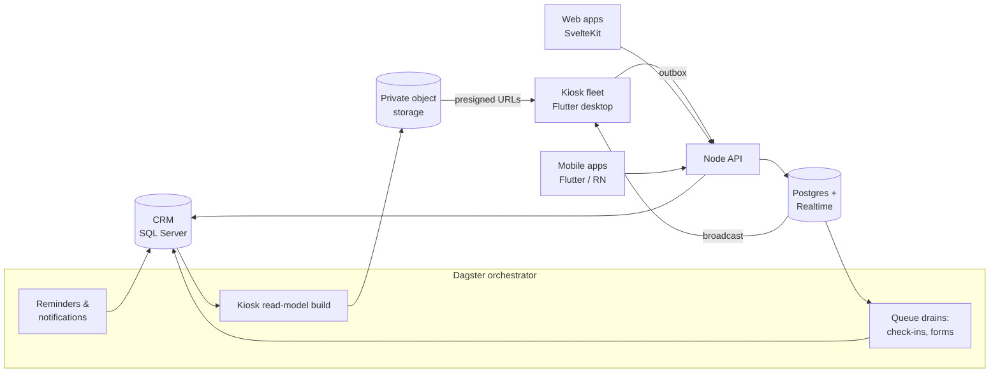

# Church Operations Platform: Engineering Case Study

**Kaleb Matthews** · Software Engineer

This is a write-up of the platform I work on for a large multi-site church. It's a polyglot
monorepo that runs Sunday check-in, registration, forms, events, groups, mobile apps and the
background jobs behind them. The source code is private. This document covers how the main
pieces work, why they were designed that way, and what I owned.

| | |
| --- | --- |
| **Scale** | 20 apps and services in one monorepo, multiple campuses, a fleet of walk-up check-in kiosks |
| **Languages** | Dart/Flutter, TypeScript, Python, C#, SQL (PostgreSQL + T-SQL) |
| **Frameworks** | Flutter (desktop + mobile), SvelteKit, React Native/Expo, Hono (Node API), Dagster |
| **Content & search** | Storyblok (headless CMS), Elasticsearch, Clerk (auth) |
| **Data** | MinistryPlatform (SQL Server CRM, system of record), Supabase Postgres + Realtime, SQLite on-device, BigQuery |
| **Tooling** | pnpm + Turborepo, uv, FVM, Riverpod, GoRouter, Valibot, Shorebird code push, Codemagic + GitHub Actions |

---

## Contents

1. [System overview](#system-overview)
2. [Check-in kiosk (Flutter desktop)](#1-check-in-kiosk-flutter-desktop)
3. [Family and student registration](#2-family-and-student-registration)
4. [Dynamic form engine](#3-dynamic-form-engine)
5. [Event and group registration](#4-event-and-group-registration)
6. [Background orchestration (Dagster)](#5-background-orchestration-dagster)
7. [Websites (SvelteKit + headless CMS)](#6-websites-sveltekit--headless-cms)
8. [Engineering practices](#engineering-practices)

---

## System overview



### What's in the monorepo

| Area | Apps and libraries |
| --- | --- |
| **Kiosk** | Flutter desktop check-in and registration for Windows, macOS and Linux |
| **Mobile** | A React Native/Expo app in production, and its **Flutter rewrite** (home, grow, connect, give and account tabs, with responsive layouts and accessibility scaling) |
| **Web** | 13 SvelteKit apps: the two public websites, central sign-in, browser check-in, camp, residency, archives, free resources and ministry microsites, plus a maintenance page and embeddable vanilla JS components |
| **API** | Node/TypeScript API (Hono, OpenAPI-described routes) with a frozen legacy surface kept for older clients |
| **CRM bridge** | A .NET/C# service that wraps the CRM vendor's SDK for record writes, file attachments and authentication |
| **Jobs** | Python/Dagster orchestrator (syncs, queue drains, notifications, search indexing, BigQuery, marketing sync, geocoding), plus a legacy Node task runner being migrated into it |
| **Database** | Supabase Postgres migrations for the schemas this repo owns, deployed per environment through a manual workflow |
| **Shared libraries** | Shared TS libs (common models and validation, server services, typed API client), a shared Svelte UI kit, and a shared Flutter package (auth, API, theme, localization, widgets) |

The CRM is the system of record, but it's a hosted SQL Server that isn't built for hundreds of
concurrent writes at 9:55 on a Sunday morning, and it can't be reached at all when a campus loses
internet. Most of the architecture follows from that: **reads come from local or cached
projections, writes go through durable queues, and the CRM is updated asynchronously.**

---

## 1. Check-in kiosk (Flutter desktop)

**My role:** primary engineer. I designed and built the kiosk app, its sync and offline model,
the fleet monitoring tools, nametag printing, and the build and release pipeline for Windows,
macOS and Linux.

The kiosk is a walk-up station where families look themselves up, check kids into classes and
print secure nametags. **It must keep working with no network**, stay consistent across every
station in the building, and never lose a check-in.

### Two isolates, two databases

```
UI isolate                              Backend isolate
──────────                              ───────────────
Check-in / Registration / Diagnostics   Device enrollment
Local writes  → offline.db              Read-model catch-up (deltas or full)
Read-only     ← master.db               Realtime subscription
Commands      → backend bridge          Outbox drain → API
```

- **`master.db`** is a read-only SQLite projection of the people, households, events and
  capacities a kiosk needs. Only the backend isolate writes to it, and only to apply a sync.
- **`offline.db`** belongs to the kiosk: the outbox, a check-in log, and *overlays* (pending
  registrations, added members, attribute edits) that are merged over `master.db` at read time.

Keeping sync, networking and retries on a separate Dart isolate means a slow download or a
reconnect storm never drops a frame on the touchscreen.

### Read path: incremental sync with integrity checks

A scheduled orchestrator job (every ~5 minutes) extracts the CRM, builds a fresh SQLite baseline,
and publishes it alongside numbered JSONL **delta** files and an index to private object storage.
Kiosks download through short-lived presigned URLs, never public reads, because the data includes
PII.

| Kiosk condition | Action |
| --- | --- |
| No baseline, or the baseline **lineage** changed | Full download |
| Local cursor is older than the delta retention window | Full download |
| Pending deltas newer than the local cursor | Apply in order, verifying each file's **SHA-256** |
| Any delta fails to fetch, verify or apply | Fall back to a full download |

Search indexes for phone and name lookup are built **on the device** when the database opens
instead of shipping inside the file. They would grow every download by ~40%. Lookups try an
indexed prefix match first and fall back to a substring scan.

### Write path: outbox, durable queue, deferred CRM write

1. The guest taps **Check-In**. The kiosk writes the outbox row and the log row in a single
   local transaction, keyed by the same UUIDv7 `changeId`.
2. A sender drains the outbox to the API with bounded retries and backoff.
3. The API inserts into a Postgres queue (**idempotent on `changeId`**), records a sync event and
   broadcasts it over Realtime. It returns 2xx **only after the insert commits**.
4. A Dagster job drains the queue into the CRM every few minutes. Rows that fail repeatedly are
   parked as `failed` for review instead of retrying forever.
5. The next sync cycle projects the CRM back into every kiosk's `master.db`.

**An ack means "durably stored", not "in the CRM".** That contract let me move the CRM write off
the request path, and Sunday-morning latency went with it, without changing kiosk behavior. If
Postgres is unreachable, the kiosk doesn't get an ack and the row stays on the device until it
delivers.

Some details I'm proud of:

- **Offline chains of dependent writes.** A family registered offline exists only as a *negative
  local ID* until the server acks it. Later actions (add a child, edit that child's allergies,
  check in) are queued against the local ID. The sender **resolves real IDs at send time**, skips
  dependents (without spending their retries) until their parent lands, then re-keys the overlays.
  A family can register and check in during one visit with no network at all.
- **Exactly-once household creation.** Registration uses a claim table: reserve pending, create in
  the CRM, then store the result. Retries get the stored household back, and an in-flight claim
  returns 503 so the outbox backs off instead of creating a duplicate family.
- **Single-use codes under concurrency.** Mobile pre-check-in codes used to rely on
  `UPDATE … WHERE redeemed IS NULL`, which was only atomic while the write was synchronous. Once
  writes were queued, two stations could both see a code as unredeemed. I moved the guarantee into
  Postgres with a partial unique index.
- **Shutdown guard.** On Windows the runner refuses `WM_QUERYENDSESSION` while sendable outbox rows
  remain. For rows that ran out of retries, it emails support once (metadata only, never the
  payload) before allowing shutdown.

### Peer consistency: Realtime with self-healing

Every station subscribes to a **private** Realtime channel using a short-lived JWT, so a check-in
on station A shows "already checked in" on station B within moments. Broadcasts are best-effort.
A paginated replay endpoint runs on reconnect, after every sync and about every 30 seconds, so
dropped packets heal on their own. Applies are serialized so a burst of multi-member check-ins
can't race the local database.

### Security model

A walk-up kiosk is a shared, unattended machine in a public hallway that holds PII for thousands
of families, so security is layered:

| Layer | Mechanism |
| --- | --- |
| Device → API | Every call is HMAC-signed with the API secret |
| Device identity | **Trust-on-first-use** enrollment issues a per-device secret. Every PII endpoint (sync file URLs, Realtime tokens, event replay, fleet roster) also requires a per-device HMAC, so a leaked API secret alone can't pull data. |
| Secret recovery | Operators can **reset a device's secret** from the fleet monitor. The station re-enrolls on its next 401 or token refresh and rejoins within ~30s. Enrollment conflicts and secret drift are surfaced on the monitor instead of failing silently. |
| PII sync files | Sync files with PII live in **private** object storage and are fetched only through short-lived presigned URLs. There is no public read path. |
| Realtime | Short-lived JWT whose claims list the exact private topics the device may join. There is **no public-channel fallback**: if the token can't be minted, the socket stays degraded and check-in continues over HTTP. |
| Staff actions | Setup, diagnostics, reprint and override all require a **TOTP** code that verifies **offline** against a synced secret and roster, with an online fallback. Unparseable admin flags fail closed. |
| Least privilege | Developer consoles in diagnostics are hidden from roster-only staff. The SQL console is read-only and blocks `PRAGMA` writes. |
| Fleet tools | Operator SSO with role checks that **fail closed** when the identity service is unreachable. Sign-up is disabled, and an SSO identity with no existing account is refused. |
| Shared-device hygiene | The SSO session is **never persisted**: the cache is wiped on entry and on exit, the embedded browser profile used for social sign-in is deleted before and after every attempt, and biometrics are disabled. |
| Auditability | Overrides record the approving staff member and the reason in the CRM. Reprints are attributed to the verified admin. |
| Minimal disclosure | Outbox failure alerts carry only metadata (machine, change ID, retry count, last error), **never the payload**. Family-edit emails resolve recipients server-side, so the kiosk never sends addresses. |
| Environment isolation | Debug builds use a separate app ID, so a developer machine's databases, device secret and outbox never mix with a release install. |

### Check-in flow and hardware

- **Stage machine:** campus → program → station setup (events, theme, print options, admin TOTP)
  → search → household picker → family screen → celebration screen.
- **Nametag printing:** secure child tags plus a matching pick-up ticket that share a per-session
  security token. Layout is versioned by remote config. The v2 layout auto-fits allergy text by
  stepping the font size down and scaling the name block before anything is cut off.
- **Admin modes:** reprint (keep the code or mint a new one, which is broadcast to every station
  so an old ticket stops matching) and an audited **override** (reason + approving staff member
  are recorded in the CRM).
- **QR check-in:** webcam scanning (vendored camera plugin + ZXing) and USB HID barcode scanners.
  The scanner uses an explicit armed state rather than typing-speed heuristics, so fast typists
  don't get misread as scanners.
- **Accessibility:** themes meet WCAG AA contrast, motion is reduced when the OS asks, and there's
  a custom on-screen keyboard and keypad so the OS touch keyboard never appears.

### Diagnostics and fleet monitoring

- A local diagnostics dashboard (staff-gated) covers device, hardware, printers, cameras, sync
  state, outbox and sync issues, plus developer consoles (including a read-only SQL console that
  blocks `PRAGMA` writes).
- A **Fleet Check-in Monitor** lists every station across campuses: live presence over a
  dedicated Realtime topic, per-station stats against last week, CRM lag, print failures, and
  5-minute CPU/memory/disk telemetry. Operators can probe a station remotely, edit its setup or
  trigger repairs.
- **Clock-skew detection** shows a banner within ~5s and alerts IT only if the skew persists,
  since TOTP fails when a clock drifts.

### Build and release

- One Flutter codebase built for **Windows (signed MSIX), macOS and Linux** in CI.
- **Shorebird** code push for patches without reinstalling the fleet.
- Debug builds use a separate app ID so a developer's local databases and device secret never mix
  with an installed release.
- ~270 source files and ~120 unit and end-to-end test files covering sync, registration, check-in
  logic and diagnostics.

---

## 2. Family and student registration

**My role:** built the kiosk registration wizards and their offline sync path.

New families register at the kiosk instead of a paper form:

- **New family:** agreement → parents and address → children → review → celebration.
- **New student:** student → parent and home → review. Grades are filtered from cached age/grade
  metadata.
- **New adult:** a short form from the "New here?" prompt when a search finds no match.

Every wizard writes a local overlay plus an outbox job, so the family **shows up and can check in
immediately**, even offline. On sync the server runs **duplicate-person matching**: exact name
plus at least 2 of phone, email and date of birth. It anchors the household to the first parent,
leaves a mismatched second parent untouched, and returns deterministic warning codes. The kiosk
files those under Sync Issues and prunes the overlay rows the server excluded. Event dropdowns in
the wizard use the **same eligibility resolver** as check-in (age, grade, childcare and capacity
rules). That resolver is ported in both Dart and TypeScript so the kiosk and the web check-in app
can't drift apart.

---

## 3. Dynamic form engine

**My role:** involved in the design across the stack: the mobile input component library,
client-side schema generation, server-side submission rules, and the high-volume
response-processing pipeline.

Ministry staff build forms in the CRM (sign-ups, interest cards, registration questions), and
every client renders them **without a code change**.

**Rendering and validation (client)**

- A form definition is a list of typed fields: text, email, phone, date, campus dropdown,
  radio/checkbox grids, file upload, section breaks, and so on.
- The engine builds a **Valibot schema at runtime** from the definition. Each field type maps to a
  shared validator (phone, postal code, email, name).
- **Conditional fields:** a field can depend on another field's value (multi-value and
  array-aware). A required dependent field is only validated **while its condition shows it**.
  Otherwise a hidden required field would make the form impossible to submit.
- **Prefill:** known profile data is matched onto fields with normalized keys, and campus values
  resolve by ID or by fuzzy name match.

**Submission and processing (server)**

- Every submission is written to a **queue table first**, so nothing is lost if downstream work
  fails.
- Processing resolves the person (by ID, or by name + email/phone matching), saves the answers,
  updates household address and campus when the form allows it, creates follow-up
  **engagements** for staff, and links event or group membership.
- **Anonymous forms** land on a catch-all contact by design. The processor saves the response but
  skips every write that would attach data to that catch-all record.
- **SMS consent follows FCC rules.** Only an explicitly checked box opts someone in, and only
  forms that include a text opt-in field can touch the opt-out list.

**Queue drain rewrite (Python/Dagster).** The old worker processed rows one at a time with a delay,
so a 10K-row campaign spike took **~80 minutes** to clear. I helped port it into a Dagster op that:

- drains in a loop within a wall-clock budget, and the schedule skips ticks while a run is going;
- **atomically claims** each row before submitting it, and stops claiming at the budget so it never
  holds rows it can't finish;
- fans work across a thread pool sized to the HTTP connection pool;
- **keeps each person's rows in order on one worker**, so a double-submit can't create the same
  person twice.

I also fixed a class of silent failures where queue errors were swallowed, and added tests for
them.

---

## 4. Event and group registration

**My role:** involved in the design of the registration flows across mobile and server, and
built and fixed the scheduled notifications around them.

**Event registration**

- A household-centric flow: pick which family members attend, choose a **capacity** (a session,
  age group, childcare or ticket tier) for each, and complete any registration form required by
  that event or capacity.
- **Server-side guards:** verifies that each existing registration belongs to that event and
  attendee, enforces age ranges and spots remaining, and **blocks online changes to paid
  registrations** (they go through a cancellation request instead).
- **Paid checkout:** a staged pipeline (validate requirements → quote with promo codes → pay →
  register). Each stage tags its errors, so a failure reports exactly where it happened, and
  abandoned checkouts are recorded.

**Group registration**

- Group search with map and list views, meeting schedule display, and a **family join flow**.
  Adults and children are split by household position and checked against each group's
  capacities.

**Notifications (Dagster)**

- **Event reminders:** hourly. Matches events whose reminder offset falls in the current hour and
  sends each registered household **one** consolidated email. I fixed a daylight-saving bug that
  shifted the window, and a bug that caused some registrants to be missed or emailed twice.
- **Group leader notifications:** texts leaders about new sign-ups, **one per phone per group**
  (it previously sent duplicates).

---

## 5. Background orchestration (Dagster)

**My role:** built and maintained the kiosk jobs and several migrations from a legacy Node task
runner.

- **Kiosk read-model build:** CRM extract → SQLite baseline + JSONL deltas + index → private
  storage. Lineage and retention rules let kiosks decide between incremental and full sync.
- **Check-in queue drain:** Postgres queue → CRM, with per-row retry limits and failure parking.
- **Search import sync:** moved all search-index import jobs for events and groups into the
  orchestrator.
- **BigQuery sync:** CRM extracts transformed for reporting.
- **Timezone discipline:** "now" for the CRM always comes from the **database server's clock**,
  never the pod. Pod timezones vary by deployment, and relabeling local time as UTC once made
  removed group members reappear.
- **Video → CMS sync:** new sermon and livestream videos are pulled into the CMS automatically,
  with a standalone script path so it keeps running when the orchestrator is down.

---

## 6. Websites (SvelteKit + headless CMS)

**My role:** involved in the design and build of the public site and the web apps around it,
including site search and the web version of kiosk check-in.

The church runs a family of SvelteKit apps: the main public website, a central sign-in app,
browser-based check-in, and smaller sites for camps, residency, archives and resources. They share
a Svelte component library and one auth model.

### Main site: CMS-driven pages

- Content lives in a **headless CMS (Storyblok)**. A catch-all route resolves any slug to a CMS
  story and renders it through a **block renderer** that maps 80+ CMS components (heroes,
  carousels, campus maps, event cards, staff listings, countdowns, galleries) to Svelte
  components. Staff build pages without a deploy.
- **Live data blocks** mix CMS layout with API data: event listings and detail pages, groups
  finder, campus-specific content, and **dynamic forms** that use the same form engine as the
  mobile apps.
- **Event registration and payment** run on the site end to end, from family selection and
  capacities to required forms and checkout.
- **Scheduled publishing:** a publish-on-date block keeps a page hidden until its date arrives,
  checked server-side so the content never reaches the browser early.
- **Visual Editor preview while signed in.** The CMS editor shows the site in an iframe, where
  `SameSite=Lax` session cookies are never sent, so every page rendered signed out. Loosening the
  shared session cookie to `SameSite=None` would have removed CSRF protection for every app that
  uses it. Instead, a popup (a top-level visit, so the real cookie is sent) hands the frame a
  short-lived signed token. The frame trades it for a **partitioned** cookie that exists only while
  the CMS is the top-level site.

### Site search

- Fuzzy search across CMS stories, tuned for how people actually ask: **question-style queries**
  ("how do I get my kid baptized?") are stripped of filler words and accent-normalized before
  matching, and results come back with thumbnails.
- Events, groups and CMS content are also indexed into a search engine by orchestrator jobs.

### Resilience: the site survives an API outage

The website can't go down because the backend did.

- **A circuit breaker on every API call.** Calls time out after 10 seconds. After 3 outage-type
  failures in a row (timeouts, connection errors, 502/503/504), the site stops calling the API for
  60 seconds, then lets one probe through.
- **A kill switch in the CMS.** Staff can tick one checkbox and publish to take the API out of the
  picture within a minute, with no deploy. Pages then render from CMS content only. API-backed
  sections render empty instead of erroring, sign-in is hidden, forms show a friendly "short
  break" message, and campuses and event tags fall back to CMS data sources.
- **Safe defaults:** a missing setting means "API on", an unreachable CMS keeps the last known
  value, and fallback logging is rate-limited.

### Auth across domains

- One central sign-in app (Clerk under the hood) is the **only** place users sign in. After sign-in
  it writes an encrypted identity cookie that every app reads. The apps run on **two different
  domains**, so a cross-domain handoff (and optionally a Clerk satellite session) carries it over.
- **No app requires a global login.** Hooks read the session optionally and never redirect. Only
  specific routes call a `require…` guard, so open pages always render for anonymous visitors.
- **Household ownership guards.** The backend trusts a server-to-server HMAC and never learns who
  is asking, so the site's API proxies enforce that a signed-in person can only read or change
  people in **their own household**. Identity always comes from the session cookie, never from
  request IDs.
- reCAPTCHA protects the public forms.

### Web check-in

A SvelteKit port of the kiosk's check-in and registration flows, with the same stages and the same
look. It reads live data through the API and **reuses the kiosk write endpoints**, so the queue,
Realtime and the fleet monitor treat a browser station exactly like a kiosk. Eligibility rules are
shared with the Dart implementation and tested on both sides.

---

## Engineering practices

- **Monorepo at scale:** four toolchains (pnpm/Turbo, uv, dotnet, FVM/Dart) behind one set of
  `lint` / `format` / `check` / `test` commands.
- **Shared logic, one source of truth:** check-in eligibility rules exist in Dart and TypeScript
  with matching tests. Auth/account UX is kept in parity across three clients (web, React Native,
  Flutter).
- **Guardrails in tooling, not tribal knowledge:** custom ESLint rules fail the build on known-bad
  time and photo-lookup idioms. Schema checks keep migrations from touching another team's
  schemas.
- **Idempotency everywhere:** UUIDv7 change IDs, claim tables, unique indexes and atomic queue
  claims, because every write path has to tolerate retries, duplicate submits and flaky networks.
- **Docs as part of the change:** the kiosk's ops README is the canonical operator doc and is
  updated alongside any functional change.

---

*Code samples and walkthroughs are available on request, subject to my employer's approval.*
